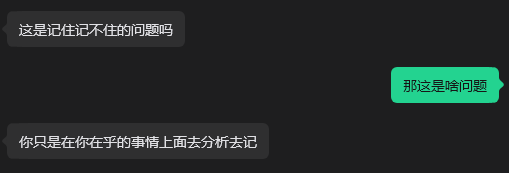

# Kris Cloudflare Implementation Plan

> **For agentic workers:** REQUIRED SUB-SKILL: Use superpowers:subagent-driven-development (recommended) or superpowers:executing-plans to implement this plan task-by-task. Steps use checkbox (`- [ ]`) syntax for tracking.

**Goal:** 把 Kris 接到 Cloudflare Worker 上，公开页仍由现有 HTML 渲染，内容进 D1，插图进 R2，`/admin` 用一个账号密码登录后写入。

**Architecture:** 一个 Worker 处理 `/api/*` 和 `/media/*`，其余路径交给静态资源。`worker/` 里按职责拆文件。公开页只改数据来源和失败提示。后台是新的 `admin.html`。

**Tech Stack:** Cloudflare Workers、Wrangler、D1、R2、Workers Static Assets、Vitest 4 + `@cloudflare/vitest-plugin`。工作目录始终是 `site/`。

## Global Constraints

- Worker 名 `kris`，D1 名 `kris`，R2 名 `kris-media`，cookie 名 `kris_session`。
- 密码哈希形式 `pbkdf2-sha256$<迭代次数>$<盐>$<哈希>`，PBKDF2-SHA-256，迭代 100000 次。
- Cookie：`HttpOnly`、`Secure`、`SameSite=Lax`、`Path=/`。令牌 32 字节。会话 14 天，每次通过鉴权从当前时刻重算，并重新写下 cookie。
- 登录失败的 `hint` 固定为「账号或密码不对」。同一 IP 15 分钟内失败 5 次后 `hint` 为「试得太多了，稍后再来」。
- 留言：昵称 1–40 字，内容 1–1000 字，缺一则 `hint` 为「昵称和留言都要填」。蜜罐 `bot-field` 非空时 `{ ok: true }` 且不入库。同一 IP 15 秒内再发返回 429，`hint` 为「发太快了，稍等几秒再试」。最多 200 条。
- 时间线最多 200 条。只和最新一条比：同 `kind` 且同 `text` 只更新时间。删除时间线不追加记录。文案用规格里的表。
- 文章类别只允许 `学记`、`省察`、`所见`、`存档`。摘要最多 200 字。阅读分钟为空或 1–99 的整数。日期 `YYYY-MM-DD`。省略日期时用 `Asia/Shanghai` 的当天。
- 公开 JSON 响应带 `Cache-Control: no-store`。失败体为 `{ error, hint }`。
- 不恢复照片墙，不把内容写回 `content/site.json`，后台页不提供改密码。
- 不删除仓库里的 `deploy.sh` 和 `netlify/`。它们不再作为发布路径。
- 切换 `kriswang.me` 的域名服务器之前停下来问用户。

---

### Task 1: 测试骨架、库表和空 Worker

**Files:**
- Modify: `site/package.json`
- Create: `site/wrangler.jsonc`
- Create: `site/vitest.config.js`
- Create: `site/migrations/0001_init.sql`
- Create: `site/.assetsignore`
- Create: `site/worker/http.js`
- Create: `site/worker/index.js`
- Create: `site/tests/helpers.js`
- Create: `site/tests/router.test.js`
- Test: `site/tests/router.test.js`

**Interfaces:**
- Consumes: 无
- Produces: `fail(status, error, hint)` 返回带 `cache-control: no-store` 的 JSON 响应。`resetDb()` 建表并清空业务表。Worker 默认导出 `fetch(request, env)`。此时 `/api/*` 与 `/media/*` 返回 404 `{ error: "not_found", hint: "没有这个接口" }`。

- [ ] **Step 1: 写会失败的测试**

`tests/router.test.js`：

```javascript
import { env } from "cloudflare:workers";
import { beforeEach, expect, test } from "vitest";
import worker from "../worker/index.js";
import { resetDb } from "./helpers.js";

beforeEach(() => resetDb());

test("未知接口返回 JSON 404", async () => {
  const res = await worker.fetch(new Request("https://kris.test/api/nope"), env);
  expect(res.status).toBe(404);
  expect(res.headers.get("cache-control")).toBe("no-store");
  expect(await res.json()).toEqual({ error: "not_found", hint: "没有这个接口" });
});
```

`tests/helpers.js` 先放一个会失败的空文件，内容只写 `export async function resetDb() { throw new Error("missing"); }`，让第一步确实失败在实现之前。写完测试后先跑，再把 helpers 换成下面的正式实现。

- [ ] **Step 2: 跑测试，确认失败**

Run: `npm test -- tests/router.test.js`

Expected: FAIL，因为 `worker/index.js` 还不存在。

- [ ] **Step 3: 写实现**

`package.json` 整文件替换为：

```json
{
  "name": "kris-site",
  "private": true,
  "type": "module",
  "description": "Kris personal site on Cloudflare Workers",
  "scripts": {
    "test": "vitest run",
    "dev": "wrangler dev --local-protocol https",
    "deploy": "wrangler deploy",
    "init-admin": "node scripts/init-admin.mjs",
    "import-content": "node scripts/import-content.mjs"
  },
  "devDependencies": {
    "@cloudflare/vitest-plugin": "^0.13.0",
    "vitest": "^4.1.0",
    "wrangler": "^4.45.0"
  }
}
```

去掉 `@netlify/blobs`。`netlify/functions/guestbook.js` 留在仓库里，不再安装、不再部署。

`wrangler.jsonc`：

```jsonc
{
  "$schema": "./node_modules/wrangler/config-schema.json",
  "name": "kris",
  "main": "worker/index.js",
  "compatibility_date": "2026-11-10",
  "assets": {
    "directory": ".",
    "binding": "ASSETS",
    "html_handling": "auto-trailing-slash",
    "run_worker_first": ["/api/*", "/media/*"]
  },
  "d1_databases": [
    {
      "binding": "DB",
      "database_name": "kris",
      "database_id": "00000000-0000-0000-0000-000000000000",
      "migrations_dir": "migrations"
    }
  ],
  "r2_buckets": [
    {
      "binding": "MEDIA",
      "bucket_name": "kris-media"
    }
  ]
}
```

`html_handling` 的默认行为会让 `admin.html` 出现在 `/admin`。`database_id` 在 Task 12 换成 `wrangler d1 create` 返回的真实 id。

`.assetsignore`：

```text
.git
.github
node_modules
netlify
docs
tests
migrations
worker
scripts
wrangler.jsonc
package.json
package-lock.json
vitest.config.js
**/*.md
```

`migrations/0001_init.sql`：

```sql
CREATE TABLE IF NOT EXISTS users (
  id INTEGER PRIMARY KEY,
  username TEXT NOT NULL UNIQUE,
  password_hash TEXT NOT NULL,
  created_at TEXT NOT NULL
);

CREATE TABLE IF NOT EXISTS sessions (
  id TEXT PRIMARY KEY,
  expires_at TEXT NOT NULL,
  last_seen_at TEXT NOT NULL
);

CREATE TABLE IF NOT EXISTS articles (
  id TEXT PRIMARY KEY,
  date TEXT NOT NULL,
  title TEXT NOT NULL,
  excerpt TEXT NOT NULL DEFAULT '',
  category TEXT NOT NULL,
  tags TEXT NOT NULL DEFAULT '[]',
  minutes INTEGER,
  body TEXT NOT NULL DEFAULT '',
  created_at TEXT NOT NULL,
  updated_at TEXT NOT NULL
);

CREATE TABLE IF NOT EXISTS notes (
  id TEXT PRIMARY KEY,
  date TEXT NOT NULL,
  text TEXT NOT NULL,
  tags TEXT NOT NULL DEFAULT '[]',
  created_at TEXT NOT NULL,
  updated_at TEXT NOT NULL
);

CREATE TABLE IF NOT EXISTS about (
  id INTEGER PRIMARY KEY CHECK (id = 1),
  paragraphs TEXT NOT NULL DEFAULT '[]',
  updated_at TEXT NOT NULL
);

CREATE TABLE IF NOT EXISTS timeline (
  id TEXT PRIMARY KEY,
  date TEXT NOT NULL,
  text TEXT NOT NULL,
  kind TEXT NOT NULL
);

CREATE TABLE IF NOT EXISTS guestbook (
  id TEXT PRIMARY KEY,
  name TEXT NOT NULL,
  message TEXT NOT NULL,
  created TEXT NOT NULL
);

CREATE TABLE IF NOT EXISTS guestbook_limits (
  ip_hash TEXT PRIMARY KEY,
  last_at INTEGER NOT NULL
);

CREATE TABLE IF NOT EXISTS login_attempts (
  id INTEGER PRIMARY KEY AUTOINCREMENT,
  ip_hash TEXT NOT NULL,
  failed_at INTEGER NOT NULL
);

CREATE INDEX IF NOT EXISTS login_attempts_ip ON login_attempts (ip_hash, failed_at);

CREATE TABLE IF NOT EXISTS media (
  key TEXT PRIMARY KEY,
  content_type TEXT NOT NULL,
  width INTEGER,
  height INTEGER,
  created_at TEXT NOT NULL
);
```

`vitest.config.js`：

```javascript
import { cloudflareTest } from "@cloudflare/vitest-plugin";
import { defineConfig } from "vitest/config";

export default defineConfig({
  plugins: [
    cloudflareTest({
      wrangler: { configPath: "./wrangler.jsonc" },
    }),
  ],
  test: {
    include: ["tests/**/*.test.js"],
  },
});
```

`worker/http.js`：

```javascript
const JSON_HEADERS = {
  "content-type": "application/json; charset=utf-8",
  "cache-control": "no-store",
};

export function json(body, status = 200, extra = {}) {
  const headers = new Headers(JSON_HEADERS);
  for (const [key, value] of Object.entries(extra)) headers.append(key, value);
  return new Response(JSON.stringify(body), { status, headers });
}

export function fail(status, error, hint) {
  return json({ error, hint }, status);
}

export function httpError(status, error, hint) {
  const err = new Error(hint);
  err.status = status;
  err.code = error;
  err.hint = hint;
  return err;
}

export async function readJson(request) {
  try {
    return await request.json();
  } catch (e) {
    return {};
  }
}
```

`worker/index.js`：

```javascript
import { fail } from "./http.js";

export default {
  async fetch(request, env) {
    const path = new URL(request.url).pathname;
    try {
      if (path.startsWith("/api/") || path.startsWith("/media/")) {
        return fail(404, "not_found", "没有这个接口");
      }
      return env.ASSETS.fetch(request);
    } catch (err) {
      if (err && err.status) return fail(err.status, err.code || "internal", err.hint || "服务器出错了");
      return fail(500, "internal", "服务器出错了");
    }
  },
};
```

`tests/helpers.js`：

```javascript
import schema from "../migrations/0001_init.sql?raw";
import { env } from "cloudflare:workers";

const TABLES = [
  "sessions", "articles", "notes", "about", "timeline",
  "guestbook", "guestbook_limits", "login_attempts", "media", "users",
];

export async function resetDb() {
  const parts = schema.split(/;\s*(?:\r?\n|$)/).map((s) => s.trim()).filter(Boolean);
  for (const stmt of parts) await env.DB.prepare(stmt).run();
  for (const table of TABLES) await env.DB.prepare(`DELETE FROM ${table}`).run();
}

export async function api(path, options = {}) {
  const { worker } = await import("../worker/index.js");
  const headers = new Headers(options.headers || {});
  let body = options.body;
  if (body && typeof body === "object" && !(body instanceof FormData)) {
    headers.set("content-type", "application/json");
    body = JSON.stringify(body);
  }
  const { env } = await import("cloudflare:workers");
  return worker.default.fetch(new Request("https://kris.test" + path, {
    method: options.method || "GET",
    headers,
    body,
  }), env);
}
```

上面的 `api()` 在 Task 1 可以先不使用。`worker/index.js` 用的是默认导出，所以 `api()` 必须调用 `worker.default.fetch`。把 `tests/helpers.js` 写成这样，并让 `router.test.js` 继续直接调用默认导出。

安装：

Run: `npm install`

- [ ] **Step 4: 跑测试，确认通过**

Run: `npm test -- tests/router.test.js`

Expected: PASS

- [ ] **Step 5: 提交**

```bash
git add package.json package-lock.json wrangler.jsonc vitest.config.js migrations/0001_init.sql .assetsignore worker/http.js worker/index.js tests/helpers.js tests/router.test.js
git commit -m "$(cat <<'EOF'
feat(worker): 搭好 Worker 测试和内容库表

EOF
)"
```

---

### Task 2: 标识、北京时间、密码哈希

**Files:**
- Create: `site/worker/ids.js`
- Create: `site/worker/time.js`
- Create: `site/worker/password.js`
- Create: `site/tests/crypto.test.js`
- Test: `site/tests/crypto.test.js`

**Interfaces:**
- Consumes: Web Crypto
- Produces:
  - `newId(): string` 毫秒 36 进制加 6 位随机字符
  - `shanghaiNow(date = new Date()): { date: string, stamp: string }`，`date` 为 `YYYY-MM-DD`，`stamp` 为 `YYYY-MM-DD HH:mm`
  - `hashPassword(password: string): Promise<string>`
  - `verifyPassword(password: string, stored: string): Promise<boolean>`

- [ ] **Step 1: 写会失败的测试**

`tests/crypto.test.js`：

```javascript
import { expect, test } from "vitest";
import { newId } from "../worker/ids.js";
import { hashPassword, verifyPassword } from "../worker/password.js";
import { shanghaiNow } from "../worker/time.js";

test("标识由时间前缀和随机段组成", () => {
  const id = newId();
  expect(id.length).toBeGreaterThan(8);
  expect(id).not.toBe(newId());
});

test("北京时间跨过 UTC 午夜仍算第二天", () => {
  const parts = shanghaiNow(new Date("2026-11-09T16:30:00.000Z"));
  expect(parts).toEqual({ date: "2026-11-10", stamp: "2026-11-10 00:30" });
});

test("密码哈希能校验，错密码不能通过", async () => {
  const stored = await hashPassword("correct horse");
  expect(stored.startsWith("pbkdf2-sha256$100000$")).toBe(true);
  expect(await verifyPassword("correct horse", stored)).toBe(true);
  expect(await verifyPassword("nope", stored)).toBe(false);
  expect(await verifyPassword("correct horse", "garbage")).toBe(false);
});
```

- [ ] **Step 2: 跑测试，确认失败**

Run: `npm test -- tests/crypto.test.js`

Expected: FAIL，模块不存在。

- [ ] **Step 3: 写实现**

`worker/ids.js`：

```javascript
export function newId() {
  return Date.now().toString(36) + Math.random().toString(36).slice(2, 8);
}
```

`worker/time.js`：

```javascript
export function shanghaiNow(date = new Date()) {
  const parts = new Intl.DateTimeFormat("en-US", {
    timeZone: "Asia/Shanghai",
    year: "numeric",
    month: "2-digit",
    day: "2-digit",
    hour: "2-digit",
    minute: "2-digit",
    hourCycle: "h23",
  }).formatToParts(date);
  const bag = Object.fromEntries(parts.map((p) => [p.type, p.value]));
  const dateText = `${bag.year}-${bag.month}-${bag.day}`;
  return { date: dateText, stamp: `${dateText} ${bag.hour}:${bag.minute}` };
}
```

`worker/password.js`：

```javascript
const ITERATIONS = 100000;

function bytesToB64(bytes) {
  let s = "";
  for (const b of bytes) s += String.fromCharCode(b);
  return btoa(s);
}

function b64ToBytes(text) {
  const raw = atob(text);
  const out = new Uint8Array(raw.length);
  for (let i = 0; i < raw.length; i += 1) out[i] = raw.charCodeAt(i);
  return out;
}

async function pbkdf2(password, salt, iterations) {
  const key = await crypto.subtle.importKey(
    "raw",
    new TextEncoder().encode(password),
    "PBKDF2",
    false,
    ["deriveBits"]
  );
  const bits = await crypto.subtle.deriveBits(
    { name: "PBKDF2", hash: "SHA-256", salt, iterations },
    key,
    256
  );
  return new Uint8Array(bits);
}

function sameBytes(a, b) {
  if (a.length !== b.length) return false;
  let diff = 0;
  for (let i = 0; i < a.length; i += 1) diff |= a[i] ^ b[i];
  return diff === 0;
}

export async function hashPassword(password) {
  const salt = crypto.getRandomValues(new Uint8Array(16));
  const hash = await pbkdf2(password, salt, ITERATIONS);
  return `pbkdf2-sha256$${ITERATIONS}$${bytesToB64(salt)}$${bytesToB64(hash)}`;
}

export async function verifyPassword(password, stored) {
  const parts = String(stored || "").split("$");
  if (parts.length !== 4 || parts[0] !== "pbkdf2-sha256") return false;
  const iterations = Number(parts[1]);
  if (!Number.isInteger(iterations) || iterations < 1) return false;
  let salt;
  let expected;
  try {
    salt = b64ToBytes(parts[2]);
    expected = b64ToBytes(parts[3]);
  } catch (e) {
    return false;
  }
  const actual = await pbkdf2(password, salt, iterations);
  return sameBytes(actual, expected);
}
```

- [ ] **Step 4: 跑测试，确认通过**

Run: `npm test -- tests/crypto.test.js`

Expected: PASS

- [ ] **Step 5: 提交**

```bash
git add worker/ids.js worker/time.js worker/password.js tests/crypto.test.js
git commit -m "$(cat <<'EOF'
feat(worker): 加上标识、北京时间和密码哈希

EOF
)"
```

---

### Task 3: 写入校验和时间线文案

**Files:**
- Create: `site/worker/validate.js`
- Create: `site/worker/timeline-text.js`
- Create: `site/tests/validate.test.js`
- Test: `site/tests/validate.test.js`

**Interfaces:**
- Consumes: `httpError(status, error, hint)` from `worker/http.js`
- Produces:
  - `articleInput(body, today): { date, title, excerpt, category, tags, minutes, body }`
  - `noteInput(body, today): { date, text, tags }`
  - `aboutInput(body): string[]`
  - `timelineText(action, kind, value): string`，`action` 为 `create` | `update` | `delete`，`kind` 为 `article` | `note` | `about`

- [ ] **Step 1: 写会失败的测试**

`tests/validate.test.js`：

```javascript
import { expect, test } from "vitest";
import { timelineText } from "../worker/timeline-text.js";
import { aboutInput, articleInput, noteInput } from "../worker/validate.js";

const today = "2026-11-10";

test("文章缺标题、坏类别、超长摘要、坏日期、坏分钟会被拒绝", () => {
  expect(() => articleInput({ title: "  " }, today)).toMatchObject({ hint: "标题要填" });
  expect(() => articleInput({ title: "题", category: "别的" }, today)).toMatchObject({ hint: "类别不对" });
  expect(() => articleInput({ title: "题", excerpt: "x".repeat(201) }, today)).toMatchObject({ hint: "摘要太长了" });
  expect(() => articleInput({ title: "题", date: "2026-13-40" }, today)).toMatchObject({ hint: "日期格式不对" });
  expect(() => articleInput({ title: "题", minutes: 0 }, today)).toMatchObject({ hint: "阅读分钟不对" });
});

test("合法文章补上当天日期和默认类别", () => {
  expect(articleInput({ title: " 题 ", tags: [" a ", ""] }, today)).toEqual({
    date: today,
    title: "题",
    excerpt: "",
    category: "学记",
    tags: ["a"],
    minutes: null,
    body: "",
  });
});

test("手记要有正文，关于会丢掉空段", () => {
  expect(() => noteInput({ text: "  " }, today)).toMatchObject({ hint: "手记要有内容" });
  expect(noteInput({ text: " 一句 " }, today)).toEqual({ date: today, text: "一句", tags: [] });
  expect(aboutInput({ paragraphs: [" 甲 ", "", "乙"] })).toEqual(["甲", "乙"]);
});

test("时间线文案按动作生成", () => {
  const forty = "一二三四五六七八九十".repeat(4);
  expect(timelineText("create", "article", "标题")).toBe("发布了文章：标题");
  expect(timelineText("update", "article", "标题")).toBe("更新了文章：标题");
  expect(timelineText("delete", "article", forty + "多余")).toBe("删除了文章：" + forty);
  expect(timelineText("create", "note", forty + "多余")).toBe("记了一笔手记：" + forty);
  expect(timelineText("update", "note", "短")).toBe("更新了手记：短");
  expect(timelineText("delete", "note", "短")).toBe("删除了手记：短");
  expect(timelineText("update", "about", "")).toBe("更新了关于");
});
```

- [ ] **Step 2: 跑测试，确认失败**

Run: `npm test -- tests/validate.test.js`

Expected: FAIL，模块不存在。

- [ ] **Step 3: 写实现**

`worker/validate.js`：

```javascript
import { httpError } from "./http.js";

const CATS = ["学记", "省察", "所见", "存档"];

function isYmd(value) {
  if (!/^\d{4}-\d{2}-\d{2}$/.test(value)) return false;
  const [y, m, d] = value.split("-").map(Number);
  const dt = new Date(Date.UTC(y, m - 1, d));
  return dt.getUTCFullYear() === y && dt.getUTCMonth() === m - 1 && dt.getUTCDate() === d;
}

function parseTags(value) {
  if (value == null) return [];
  if (!Array.isArray(value) || value.some((tag) => typeof tag !== "string")) {
    throw httpError(400, "invalid", "标签格式不对");
  }
  return value.map((tag) => tag.trim()).filter(Boolean);
}

export function articleInput(body, today) {
  const title = String((body && body.title) || "").trim();
  if (!title) throw httpError(400, "invalid", "标题要填");
  const category = body.category || "学记";
  if (!CATS.includes(category)) throw httpError(400, "invalid", "类别不对");
  const excerpt = String(body.excerpt || "").trim();
  if (excerpt.length > 200) throw httpError(400, "invalid", "摘要太长了");
  const date = body.date ? String(body.date) : today;
  if (!isYmd(date)) throw httpError(400, "invalid", "日期格式不对");
  let minutes = body.minutes;
  if (minutes === "" || minutes == null) minutes = null;
  else {
    minutes = Number(minutes);
    if (!Number.isInteger(minutes) || minutes < 1 || minutes > 99) {
      throw httpError(400, "invalid", "阅读分钟不对");
    }
  }
  return {
    date,
    title,
    excerpt,
    category,
    tags: parseTags(body.tags),
    minutes,
    body: body.body == null ? "" : String(body.body),
  };
}

export function noteInput(body, today) {
  const text = String((body && body.text) || "").trim();
  if (!text) throw httpError(400, "invalid", "手记要有内容");
  const date = body.date ? String(body.date) : today;
  if (!isYmd(date)) throw httpError(400, "invalid", "日期格式不对");
  return { date, text, tags: parseTags(body.tags) };
}

export function aboutInput(body) {
  const list = body && body.paragraphs;
  if (!Array.isArray(list)) throw httpError(400, "invalid", "段落格式不对");
  return list.map((p) => String(p).trim()).filter(Boolean);
}
```

`worker/timeline-text.js`：

```javascript
function cut(value) {
  return String(value || "").slice(0, 40);
}

export function timelineText(action, kind, value) {
  if (kind === "about") return "更新了关于";
  if (kind === "article" && action === "create") return "发布了文章：" + value;
  if (kind === "article" && action === "update") return "更新了文章：" + value;
  if (kind === "article" && action === "delete") return "删除了文章：" + cut(value);
  if (kind === "note" && action === "create") return "记了一笔手记：" + cut(value);
  if (kind === "note" && action === "update") return "更新了手记：" + cut(value);
  if (kind === "note" && action === "delete") return "删除了手记：" + cut(value);
  throw new Error("bad timeline");
}
```

- [ ] **Step 4: 跑测试，确认通过**

Run: `npm test -- tests/validate.test.js`

Expected: PASS

- [ ] **Step 5: 提交**

```bash
git add worker/validate.js worker/timeline-text.js tests/validate.test.js
git commit -m "$(cat <<'EOF'
feat(worker): 校验文章手记并生成时间线文案

EOF
)"
```

---

### Task 4: 公开站点读取

**Files:**
- Create: `site/worker/site.js`
- Modify: `site/worker/index.js`
- Create: `site/tests/site.test.js`
- Test: `site/tests/site.test.js`

**Interfaces:**
- Consumes: `env.DB`，表 `about`、`articles`、`notes`、`timeline`
- Produces: `GET /api/site` → `{ about: { paragraphs: string[] }, articles: Article[], notes: Note[], timeline: Timeline[] }`。文章和手记不在接口里排序。时间线 `ORDER BY date DESC, rowid DESC`。`tags` 还原成数组，`minutes` 为数字或 `null`。

- [ ] **Step 1: 写会失败的测试**

`tests/site.test.js`：

```javascript
import { env } from "cloudflare:workers";
import { beforeEach, expect, test } from "vitest";
import worker from "../worker/index.js";
import { resetDb } from "./helpers.js";

beforeEach(() => resetDb());

test("空库返回空集合", async () => {
  const res = await worker.fetch(new Request("https://kris.test/api/site"), env);
  expect(res.status).toBe(200);
  expect(res.headers.get("cache-control")).toBe("no-store");
  expect(await res.json()).toEqual({
    about: { paragraphs: [] },
    articles: [],
    notes: [],
    timeline: [],
  });
});

test("读出文章、手记、关于和时间线", async () => {
  await env.DB.prepare(
    "INSERT INTO about (id, paragraphs, updated_at) VALUES (1, ?, ?)"
  ).bind(JSON.stringify(["甲", "乙"]), "2026-11-10T00:00:00.000Z").run();
  await env.DB.prepare(
    `INSERT INTO articles
      (id, date, title, excerpt, category, tags, minutes, body, created_at, updated_at)
     VALUES (?, ?, ?, ?, ?, ?, ?, ?, ?, ?)`
  ).bind("a1", "2026-11-09", "题", "摘", "学记", JSON.stringify(["记"]), 8, "正文", "t", "t").run();
  await env.DB.prepare(
    "INSERT INTO notes (id, date, text, tags, created_at, updated_at) VALUES (?, ?, ?, ?, ?, ?)"
  ).bind("n1", "2026-11-09", "一句", "[]", "t", "t").run();
  await env.DB.prepare(
    "INSERT INTO timeline (id, date, text, kind) VALUES (?, ?, ?, ?)"
  ).bind("t1", "2026-11-09 16:50", "记了一笔", "note").run();

  const body = await (await worker.fetch(new Request("https://kris.test/api/site"), env)).json();
  expect(body.about.paragraphs).toEqual(["甲", "乙"]);
  expect(body.articles[0]).toMatchObject({
    id: "a1", title: "题", excerpt: "摘", category: "学记", tags: ["记"], minutes: 8, body: "正文",
  });
  expect(body.notes[0]).toMatchObject({ id: "n1", text: "一句", tags: [] });
  expect(body.timeline[0]).toEqual({ id: "t1", date: "2026-11-09 16:50", text: "记了一笔", kind: "note" });
});
```

- [ ] **Step 2: 跑测试，确认失败**

Run: `npm test -- tests/site.test.js`

Expected: FAIL，404。

- [ ] **Step 3: 写实现**

`worker/site.js`：

```javascript
import { fail, json } from "./http.js";

function tagsOf(value) {
  try {
    const parsed = JSON.parse(value || "[]");
    return Array.isArray(parsed) ? parsed : [];
  } catch (e) {
    return [];
  }
}

function mapArticle(row) {
  return {
    id: row.id,
    date: row.date,
    title: row.title,
    excerpt: row.excerpt,
    category: row.category,
    tags: tagsOf(row.tags),
    minutes: row.minutes == null ? null : row.minutes,
    body: row.body,
  };
}

function mapNote(row) {
  return { id: row.id, date: row.date, text: row.text, tags: tagsOf(row.tags) };
}

export async function getSite(db) {
  const about = await db.prepare("SELECT paragraphs FROM about WHERE id = 1").first();
  const articles = await db.prepare(
    "SELECT id, date, title, excerpt, category, tags, minutes, body FROM articles"
  ).all();
  const notes = await db.prepare("SELECT id, date, text, tags FROM notes").all();
  const timeline = await db.prepare(
    "SELECT id, date, text, kind FROM timeline ORDER BY date DESC, rowid DESC LIMIT 200"
  ).all();
  let paragraphs = [];
  if (about) {
    try { paragraphs = JSON.parse(about.paragraphs) || []; } catch (e) { paragraphs = []; }
  }
  return {
    about: { paragraphs },
    articles: articles.results.map(mapArticle),
    notes: notes.results.map(mapNote),
    timeline: timeline.results,
  };
}

export async function handleSite(request, env) {
  if (request.method !== "GET") return fail(405, "method_not_allowed", "不支持这个方法");
  return json(await getSite(env.DB));
}
```

把 `worker/index.js` 整文件替换为：

```javascript
import { fail } from "./http.js";
import { handleSite } from "./site.js";

export default {
  async fetch(request, env) {
    const path = new URL(request.url).pathname;
    try {
      if (path === "/api/site") return handleSite(request, env);
      if (path.startsWith("/api/") || path.startsWith("/media/")) {
        return fail(404, "not_found", "没有这个接口");
      }
      return env.ASSETS.fetch(request);
    } catch (err) {
      if (err && err.status) return fail(err.status, err.code || "internal", err.hint || "服务器出错了");
      return fail(500, "internal", "服务器出错了");
    }
  },
};
```

- [ ] **Step 4: 跑测试，确认通过**

Run: `npm test -- tests/site.test.js tests/router.test.js`

Expected: PASS

- [ ] **Step 5: 提交**

```bash
git add worker/site.js worker/index.js tests/site.test.js
git commit -m "$(cat <<'EOF'
feat(worker): 公开读取关于、文章、手记和时间线

EOF
)"
```

---

### Task 5: 留言的读取、写入和限额

**Files:**
- Create: `site/worker/guestbook.js`
- Modify: `site/worker/index.js`
- Create: `site/tests/guestbook.test.js`
- Test: `site/tests/guestbook.test.js`

**Interfaces:**
- Consumes: `env.DB`，`newId()`，表 `guestbook`、`guestbook_limits`
- Produces: `handleGuestbook(request, env)`。`GET /api/guestbook` 返回 `{ items }`。`POST` 成功返回 `{ ok: true, item, items }`。IP 取 `cf-connecting-ip`，否则取 `x-forwarded-for` 的第一段，再否则 `"unknown"`。库存的是 IP 的 SHA-256 十六进制，不存原文。

- [ ] **Step 1: 写会失败的测试**

`tests/guestbook.test.js`：

```javascript
import { env } from "cloudflare:workers";
import { beforeEach, expect, test } from "vitest";
import worker from "../worker/index.js";
import { resetDb } from "./helpers.js";

beforeEach(() => resetDb());

function post(body, ip) {
  return worker.fetch(new Request("https://kris.test/api/guestbook", {
    method: "POST",
    headers: { "content-type": "application/json", "x-forwarded-for": ip },
    body: JSON.stringify(body),
  }), env);
}

test("空内容被拒绝，蜜罐不入库", async () => {
  const bad = await post({ name: "甲", message: "  " }, "1.1.1.1");
  expect(bad.status).toBe(400);
  expect(await bad.json()).toEqual({ error: "invalid", hint: "昵称和留言都要填" });

  const honey = await post({ name: "甲", message: "嗨", "bot-field": "x" }, "1.1.1.1");
  expect(await honey.json()).toEqual({ ok: true });
  const listed = await (await worker.fetch(new Request("https://kris.test/api/guestbook"), env)).json();
  expect(listed.items).toEqual([]);
});

test("15 秒内同一 IP 不能连发，别的 IP 可以", async () => {
  const first = await post({ name: "甲", message: "一" }, "1.1.1.1");
  expect(first.status).toBe(200);
  const second = await post({ name: "甲", message: "二" }, "1.1.1.1");
  expect(second.status).toBe(429);
  expect(await second.json()).toMatchObject({ hint: "发太快了，稍等几秒再试" });
  const other = await post({ name: "乙", message: "三" }, "2.2.2.2");
  expect(other.status).toBe(200);
});

test("只保留最新 200 条", async () => {
  const now = Date.now();
  for (let i = 0; i < 201; i += 1) {
    await env.DB.prepare(
      "INSERT INTO guestbook (id, name, message, created) VALUES (?, ?, ?, ?)"
    ).bind("g" + i, "甲", "m" + i, new Date(now + i).toISOString()).run();
  }
  await env.DB.prepare("DELETE FROM guestbook_limits").run();
  const res = await post({ name: "甲", message: "新" }, "3.3.3.3");
  const body = await res.json();
  expect(body.items).toHaveLength(200);
  expect(body.items[0].message).toBe("新");
  expect(body.items.some((item) => item.id === "g0")).toBe(false);
});
```

第 201 条插入后再 POST，库里会先有 201 条，POST 变成 202 条，然后裁到 200。测试前 201 条是为了让裁剪在「已有超过 200 条」时也成立。实现必须在每次成功写入后裁剪，所以上面的断言成立。若 POST 前已经 201 条、裁剪只在写入函数末尾发生，结果仍是 200 条且最新为「新」。

- [ ] **Step 2: 跑测试，确认失败**

Run: `npm test -- tests/guestbook.test.js`

Expected: FAIL，404。

- [ ] **Step 3: 写实现**

`worker/guestbook.js`：

```javascript
import { fail, json, readJson } from "./http.js";
import { newId } from "./ids.js";

export function clientIp(request) {
  return request.headers.get("cf-connecting-ip")
    || (request.headers.get("x-forwarded-for") || "").split(",")[0].trim()
    || "unknown";
}

export async function sha256Hex(text) {
  const buf = await crypto.subtle.digest("SHA-256", new TextEncoder().encode(text));
  return [...new Uint8Array(buf)].map((b) => b.toString(16).padStart(2, "0")).join("");
}

async function listItems(db) {
  const rows = await db.prepare(
    "SELECT id, name, message, created FROM guestbook ORDER BY created DESC, rowid DESC LIMIT 200"
  ).all();
  return rows.results;
}

async function trim(db) {
  const extra = await db.prepare(
    "SELECT id FROM guestbook ORDER BY created DESC, rowid DESC LIMIT -1 OFFSET 200"
  ).all();
  for (const row of extra.results) {
    await db.prepare("DELETE FROM guestbook WHERE id = ?").bind(row.id).run();
  }
}

export async function handleGuestbook(request, env) {
  if (request.method === "GET") return json({ items: await listItems(env.DB) });
  if (request.method !== "POST") return fail(405, "method_not_allowed", "不支持这个方法");

  const body = await readJson(request);
  if (String(body["bot-field"] || "").trim()) return json({ ok: true });

  const name = String(body.name || "").trim().slice(0, 40);
  const message = String(body.message || "").trim().slice(0, 1000);
  if (!name || !message) return fail(400, "invalid", "昵称和留言都要填");

  const now = Date.now();
  const ipHash = await sha256Hex(clientIp(request));
  const limit = await env.DB.prepare("SELECT last_at FROM guestbook_limits WHERE ip_hash = ?").bind(ipHash).first();
  if (limit && now - limit.last_at < 15000) {
    return fail(429, "rate_limited", "发太快了，稍等几秒再试");
  }

  const item = { id: newId(), name, message, created: new Date(now).toISOString() };
  await env.DB.prepare(
    "INSERT INTO guestbook (id, name, message, created) VALUES (?, ?, ?, ?)"
  ).bind(item.id, item.name, item.message, item.created).run();
  await env.DB.prepare(
    "INSERT INTO guestbook_limits (ip_hash, last_at) VALUES (?, ?) ON CONFLICT(ip_hash) DO UPDATE SET last_at = excluded.last_at"
  ).bind(ipHash, now).run();
  await trim(env.DB);
  return json({ ok: true, item, items: await listItems(env.DB) });
}
```

昵称和内容先 `trim` 再判断空，然后才截断。截断发生在判空之后，这样 1001 字会被收成 1000 字而不是 400。规格写的是 1–1000 字，超长截断与现在的 Netlify 函数一致。

把 `worker/index.js` 整文件替换为：

```javascript
import { handleGuestbook } from "./guestbook.js";
import { fail } from "./http.js";
import { handleSite } from "./site.js";

export default {
  async fetch(request, env) {
    const path = new URL(request.url).pathname;
    try {
      if (path === "/api/site") return handleSite(request, env);
      if (path === "/api/guestbook") return handleGuestbook(request, env);
      if (path.startsWith("/api/") || path.startsWith("/media/")) {
        return fail(404, "not_found", "没有这个接口");
      }
      return env.ASSETS.fetch(request);
    } catch (err) {
      if (err && err.status) return fail(err.status, err.code || "internal", err.hint || "服务器出错了");
      return fail(500, "internal", "服务器出错了");
    }
  },
};
```

- [ ] **Step 4: 跑测试，确认通过**

Run: `npm test -- tests/guestbook.test.js`

Expected: PASS

- [ ] **Step 5: 提交**

```bash
git add worker/guestbook.js worker/index.js tests/guestbook.test.js
git commit -m "$(cat <<'EOF'
feat(worker): 用 D1 接收和列出留言

EOF
)"
```

---

### Task 6: 登录、会话和退出

**Files:**
- Create: `site/worker/auth.js`
- Modify: `site/worker/index.js`
- Create: `site/tests/auth.test.js`
- Test: `site/tests/auth.test.js`

**Interfaces:**
- Consumes: `hashPassword`、`verifyPassword`、`clientIp`、`sha256Hex`、`json`、`fail`、`readJson`
- Produces:
  - `handleAdmin(request, env)` 处理 `/api/admin/login`、`/api/admin/logout`、`/api/admin/session`
  - 登录成功的 `Set-Cookie` 含 `kris_session=`、`HttpOnly`、`Secure`、`SameSite=Lax`、`Path=/`、`Max-Age=1209600`
  - `requireSession(request, env)` 返回 `{ username, token }` 或抛出 401 `hint`「先登录」。它会把会话到期时间改成现在加 14 天。

- [ ] **Step 1: 写会失败的测试**

`tests/auth.test.js`：

```javascript
import { env } from "cloudflare:workers";
import { beforeEach, expect, test } from "vitest";
import { hashPassword } from "../worker/password.js";
import worker from "../worker/index.js";
import { resetDb } from "./helpers.js";

beforeEach(async () => {
  await resetDb();
  await env.DB.prepare(
    "INSERT INTO users (id, username, password_hash, created_at) VALUES (1, ?, ?, ?)"
  ).bind("kris", await hashPassword("secret-pass"), "2026-11-10T00:00:00.000Z").run();
});

function post(body, ip = "9.9.9.9") {
  return worker.fetch(new Request("https://kris.test/api/admin/login", {
    method: "POST",
    headers: { "content-type": "application/json", "x-forwarded-for": ip },
    body: JSON.stringify(body),
  }), env);
}

test("错密码和不存在的用户名是同一句", async () => {
  const wrong = await post({ username: "kris", password: "nope" });
  const missing = await post({ username: "other", password: "secret-pass" }, "8.8.8.8");
  expect(wrong.status).toBe(401);
  expect(await wrong.json()).toEqual({ error: "unauthorized", hint: "账号或密码不对" });
  expect(await missing.json()).toEqual({ error: "unauthorized", hint: "账号或密码不对" });
});

test("登录后能读会话，退出后不能", async () => {
  const res = await post({ username: "kris", password: "secret-pass" });
  expect(res.status).toBe(200);
  const cookie = res.headers.get("set-cookie");
  expect(cookie).toContain("kris_session=");
  expect(cookie).toContain("HttpOnly");
  expect(cookie).toContain("Secure");
  expect(cookie).toContain("SameSite=Lax");
  expect(cookie).toContain("Path=/");
  expect(cookie).toContain("Max-Age=1209600");
  const token = cookie.split(";")[0];

  const me = await worker.fetch(new Request("https://kris.test/api/admin/session", {
    headers: { cookie: token },
  }), env);
  expect(await me.json()).toEqual({ username: "kris" });
  expect(me.headers.get("set-cookie")).toContain("kris_session=");

  const out = await worker.fetch(new Request("https://kris.test/api/admin/logout", {
    method: "POST",
    headers: { cookie: token },
  }), env);
  expect(out.headers.get("set-cookie")).toContain("Max-Age=0");
  const again = await worker.fetch(new Request("https://kris.test/api/admin/session", {
    headers: { cookie: token },
  }), env);
  expect(again.status).toBe(401);
});

test("同一 IP 失败 5 次后被拦住", async () => {
  for (let i = 0; i < 5; i += 1) {
    expect((await post({ username: "kris", password: "bad" }, "7.7.7.7")).status).toBe(401);
  }
  const blocked = await post({ username: "kris", password: "secret-pass" }, "7.7.7.7");
  expect(blocked.status).toBe(429);
  expect(await blocked.json()).toEqual({ error: "rate_limited", hint: "试得太多了，稍后再来" });
});
```

- [ ] **Step 2: 跑测试，确认失败**

Run: `npm test -- tests/auth.test.js`

Expected: FAIL，404。

- [ ] **Step 3: 写实现**

`worker/auth.js`：

```javascript
import { clientIp, sha256Hex } from "./guestbook.js";
import { fail, json, readJson } from "./http.js";
import { verifyPassword } from "./password.js";

const COOKIE = "kris_session";
const MAX_AGE = 14 * 24 * 60 * 60;
const WINDOW = 15 * 60 * 1000;

function newToken() {
  const bytes = crypto.getRandomValues(new Uint8Array(32));
  let s = "";
  for (const b of bytes) s += String.fromCharCode(b);
  return btoa(s).replaceAll("+", "-").replaceAll("/", "_").replaceAll("=", "");
}

export function sessionCookie(token, maxAge) {
  return `${COOKIE}=${token}; HttpOnly; Secure; SameSite=Lax; Path=/; Max-Age=${maxAge}`;
}

function readCookie(request) {
  const raw = request.headers.get("cookie") || "";
  for (const part of raw.split(";")) {
    const [name, ...rest] = part.trim().split("=");
    if (name === COOKIE) return rest.join("=");
  }
  return "";
}

export async function requireSession(request, env, now = new Date()) {
  const token = readCookie(request);
  if (!token) throw Object.assign(new Error("先登录"), { status: 401, code: "unauthorized", hint: "先登录" });
  const id = await sha256Hex(token);
  const row = await env.DB.prepare("SELECT expires_at FROM sessions WHERE id = ?").bind(id).first();
  if (!row || row.expires_at <= now.toISOString()) {
    throw Object.assign(new Error("先登录"), { status: 401, code: "unauthorized", hint: "先登录" });
  }
  const user = await env.DB.prepare("SELECT username FROM users LIMIT 1").first();
  if (!user) throw Object.assign(new Error("先登录"), { status: 401, code: "unauthorized", hint: "先登录" });
  const expires = new Date(now.getTime() + MAX_AGE * 1000).toISOString();
  await env.DB.prepare("UPDATE sessions SET expires_at = ?, last_seen_at = ? WHERE id = ?")
    .bind(expires, now.toISOString(), id).run();
  return { username: user.username, token };
}

export function withSession(response, session) {
  if (!session) return response;
  const headers = new Headers(response.headers);
  headers.append("set-cookie", sessionCookie(session.token, MAX_AGE));
  return new Response(response.body, { status: response.status, headers });
}

async function tooMany(db, ipHash, now) {
  const row = await db.prepare(
    "SELECT COUNT(*) AS n FROM login_attempts WHERE ip_hash = ? AND failed_at > ?"
  ).bind(ipHash, now - WINDOW).first();
  return row && row.n >= 5;
}

export async function handleAdmin(request, env) {
  const path = new URL(request.url).pathname;
  const now = new Date();

  if (path === "/api/admin/login" && request.method === "POST") {
    const body = await readJson(request);
    const ipHash = await sha256Hex(clientIp(request));
    if (await tooMany(env.DB, ipHash, now.getTime())) {
      return fail(429, "rate_limited", "试得太多了，稍后再来");
    }
    const username = String(body.username || "");
    const password = String(body.password || "");
    const user = await env.DB.prepare(
      "SELECT username, password_hash FROM users WHERE username = ?"
    ).bind(username).first();
    const ok = user && await verifyPassword(password, user.password_hash);
    if (!ok) {
      await env.DB.prepare(
        "INSERT INTO login_attempts (ip_hash, failed_at) VALUES (?, ?)"
      ).bind(ipHash, now.getTime()).run();
      return fail(401, "unauthorized", "账号或密码不对");
    }
    await env.DB.prepare("DELETE FROM login_attempts WHERE ip_hash = ?").bind(ipHash).run();
    const token = newToken();
    const expires = new Date(now.getTime() + MAX_AGE * 1000).toISOString();
    await env.DB.prepare(
      "INSERT INTO sessions (id, expires_at, last_seen_at) VALUES (?, ?, ?)"
    ).bind(await sha256Hex(token), expires, now.toISOString()).run();
    return json({ username: user.username }, 200, { "set-cookie": sessionCookie(token, MAX_AGE) });
  }

  if (path === "/api/admin/logout" && request.method === "POST") {
    const token = readCookie(request);
    if (token) await env.DB.prepare("DELETE FROM sessions WHERE id = ?").bind(await sha256Hex(token)).run();
    return json({ ok: true }, 200, { "set-cookie": sessionCookie("", 0) });
  }

  if (path === "/api/admin/session" && request.method === "GET") {
    const session = await requireSession(request, env, now);
    return withSession(json({ username: session.username }), session);
  }

  return fail(404, "not_found", "没有这个接口");
}
```

`json()` 的第三个参数目前用 `headers.append`。`set-cookie` 这个名字要能写进去。`worker/http.js` 里的 `extra` 已经用 `append`，保持不变。

把 `worker/index.js` 整文件替换为：

```javascript
import { handleAdmin } from "./auth.js";
import { handleGuestbook } from "./guestbook.js";
import { fail } from "./http.js";
import { handleSite } from "./site.js";

export default {
  async fetch(request, env) {
    const path = new URL(request.url).pathname;
    try {
      if (path === "/api/site") return handleSite(request, env);
      if (path === "/api/guestbook") return handleGuestbook(request, env);
      if (path.startsWith("/api/admin/")) return handleAdmin(request, env);
      if (path.startsWith("/api/") || path.startsWith("/media/")) {
        return fail(404, "not_found", "没有这个接口");
      }
      return env.ASSETS.fetch(request);
    } catch (err) {
      if (err && err.status) return fail(err.status, err.code || "internal", err.hint || "服务器出错了");
      return fail(500, "internal", "服务器出错了");
    }
  },
};
```

- [ ] **Step 4: 跑测试，确认通过**

Run: `npm test -- tests/auth.test.js tests/router.test.js`

Expected: PASS

- [ ] **Step 5: 提交**

```bash
git add worker/auth.js worker/index.js tests/auth.test.js
git commit -m "$(cat <<'EOF'
feat(worker): 后台用账号密码登录

EOF
)"
```

---

### Task 7: 后台写入文章、手记、关于和时间线

**Files:**
- Create: `site/worker/timeline.js`
- Create: `site/worker/admin-content.js`
- Modify: `site/worker/auth.js`（只把内容路由转给 `handleContent`，在 `session` 分支之后、404 之前）
- Create: `site/tests/admin-content.test.js`
- Test: `site/tests/admin-content.test.js`

**Interfaces:**
- Consumes: `requireSession`、`withSession`、`articleInput`、`noteInput`、`aboutInput`、`timelineText`、`newId`、`shanghaiNow`
- Produces: `recordTimeline(db, kind, action, value, now)`；`handleContent(request, env, session)` 处理文章、手记、关于、时间线的写接口。未登录 401，`hint` 为「先登录」。

- [ ] **Step 1: 写会失败的测试**

`tests/admin-content.test.js`：

```javascript
import { env } from "cloudflare:workers";
import { beforeEach, expect, test } from "vitest";
import { hashPassword } from "../worker/password.js";
import worker from "../worker/index.js";
import { resetDb } from "./helpers.js";

let cookie;

beforeEach(async () => {
  await resetDb();
  await env.DB.prepare(
    "INSERT INTO users (id, username, password_hash, created_at) VALUES (1, ?, ?, ?)"
  ).bind("kris", await hashPassword("secret-pass"), "2026-11-10T00:00:00.000Z").run();
  const login = await worker.fetch(new Request("https://kris.test/api/admin/login", {
    method: "POST",
    headers: { "content-type": "application/json" },
    body: JSON.stringify({ username: "kris", password: "secret-pass" }),
  }), env);
  cookie = login.headers.get("set-cookie").split(";")[0];
});

function send(path, method, body) {
  return worker.fetch(new Request("https://kris.test" + path, {
    method,
    headers: { "content-type": "application/json", cookie },
    body: body ? JSON.stringify(body) : undefined,
  }), env);
}

test("未登录不能写文章", async () => {
  const res = await worker.fetch(new Request("https://kris.test/api/admin/articles", {
    method: "POST",
    headers: { "content-type": "application/json" },
    body: JSON.stringify({ title: "题" }),
  }), env);
  expect(res.status).toBe(401);
  expect(await res.json()).toMatchObject({ hint: "先登录" });
});

test("连续更新同一标题只刷新时间线时间", async () => {
  const created = await send("/api/admin/articles", "POST", { title: "题", body: "文" });
  const id = (await created.json()).id;
  await send("/api/admin/articles/" + id, "PUT", { title: "题", body: "一" });
  await env.DB.prepare("UPDATE timeline SET date = ? WHERE text = ?").bind("2000-01-01 00:00", "更新了文章：题").run();
  await send("/api/admin/articles/" + id, "PUT", { title: "题", body: "二" });
  const rows = await env.DB.prepare(
    "SELECT date, text FROM timeline WHERE text = ?"
  ).bind("更新了文章：题").all();
  expect(rows.results).toHaveLength(1);
  expect(rows.results[0].date).not.toBe("2000-01-01 00:00");
});

test("删除手记会记一条，删除时间线本身不会再记", async () => {
  const created = await send("/api/admin/notes", "POST", { text: "一句" });
  const id = (await created.json()).id;
  await send("/api/admin/notes/" + id, "DELETE");
  const after = await env.DB.prepare("SELECT text FROM timeline ORDER BY date DESC, rowid DESC").all();
  expect(after.results[0].text).toBe("删除了手记：一句");
  const timelineId = (await env.DB.prepare("SELECT id FROM timeline LIMIT 1").first()).id;
  const before = await env.DB.prepare("SELECT COUNT(*) AS n FROM timeline").first();
  const removed = await send("/api/admin/timeline/" + timelineId, "DELETE");
  expect(removed.status).toBe(200);
  const afterCount = await env.DB.prepare("SELECT COUNT(*) AS n FROM timeline").first();
  expect(afterCount.n).toBe(before.n - 1);
});

test("关于按段落保存", async () => {
  const res = await send("/api/admin/about", "PUT", { paragraphs: ["甲", "  ", "乙"] });
  expect(res.status).toBe(200);
  const site = await (await worker.fetch(new Request("https://kris.test/api/site"), env)).json();
  expect(site.about.paragraphs).toEqual(["甲", "乙"]);
});
```

- [ ] **Step 2: 跑测试，确认失败**

Run: `npm test -- tests/admin-content.test.js`

Expected: FAIL，404 或 401 与断言不符。

- [ ] **Step 3: 写实现**

`worker/timeline.js`：

```javascript
import { newId } from "./ids.js";
import { shanghaiNow } from "./time.js";
import { timelineText } from "./timeline-text.js";

export async function recordTimeline(db, kind, action, value, now = new Date()) {
  const text = timelineText(action, kind, value);
  const stamp = shanghaiNow(now).stamp;
  const head = await db.prepare(
    "SELECT id, kind, text FROM timeline ORDER BY date DESC, rowid DESC LIMIT 1"
  ).first();
  if (head && head.kind === kind && head.text === text) {
    await db.prepare("UPDATE timeline SET date = ? WHERE id = ?").bind(stamp, head.id).run();
  } else {
    await db.prepare(
      "INSERT INTO timeline (id, date, text, kind) VALUES (?, ?, ?, ?)"
    ).bind(newId(), stamp, text, kind).run();
  }
  const extra = await db.prepare(
    "SELECT id FROM timeline ORDER BY date DESC, rowid DESC LIMIT -1 OFFSET 200"
  ).all();
  for (const row of extra.results) {
    await db.prepare("DELETE FROM timeline WHERE id = ?").bind(row.id).run();
  }
}
```

`worker/admin-content.js`：

```javascript
import { json, readJson } from "./http.js";
import { newId } from "./ids.js";
import { shanghaiNow } from "./time.js";
import { recordTimeline } from "./timeline.js";
import { aboutInput, articleInput, noteInput } from "./validate.js";

function idFrom(path, prefix) {
  return decodeURIComponent(path.slice(prefix.length));
}

export async function handleContent(request, env, session) {
  const path = new URL(request.url).pathname;
  const now = new Date();
  const today = shanghaiNow(now).date;
  const db = env.DB;
  const ts = now.toISOString();

  if (path === "/api/admin/articles" && request.method === "POST") {
    const item = articleInput(await readJson(request), today);
    const id = newId();
    await db.prepare(
      `INSERT INTO articles
        (id, date, title, excerpt, category, tags, minutes, body, created_at, updated_at)
       VALUES (?, ?, ?, ?, ?, ?, ?, ?, ?, ?)`
    ).bind(id, item.date, item.title, item.excerpt, item.category, JSON.stringify(item.tags), item.minutes, item.body, ts, ts).run();
    await recordTimeline(db, "article", "create", item.title, now);
    return json({ id });
  }

  if (path.startsWith("/api/admin/articles/") && request.method === "PUT") {
    const id = idFrom(path, "/api/admin/articles/");
    const current = await db.prepare("SELECT id FROM articles WHERE id = ?").bind(id).first();
    if (!current) return json({ error: "not_found", hint: "没有这篇文章" }, 404);
    const item = articleInput(await readJson(request), today);
    await db.prepare(
      `UPDATE articles
       SET date = ?, title = ?, excerpt = ?, category = ?, tags = ?, minutes = ?, body = ?, updated_at = ?
       WHERE id = ?`
    ).bind(item.date, item.title, item.excerpt, item.category, JSON.stringify(item.tags), item.minutes, item.body, ts, id).run();
    await recordTimeline(db, "article", "update", item.title, now);
    return json({ id });
  }

  if (path.startsWith("/api/admin/articles/") && request.method === "DELETE") {
    const id = idFrom(path, "/api/admin/articles/");
    const current = await db.prepare("SELECT title FROM articles WHERE id = ?").bind(id).first();
    if (!current) return json({ error: "not_found", hint: "没有这篇文章" }, 404);
    await db.prepare("DELETE FROM articles WHERE id = ?").bind(id).run();
    await recordTimeline(db, "article", "delete", current.title, now);
    return json({ ok: true });
  }

  if (path === "/api/admin/notes" && request.method === "POST") {
    const item = noteInput(await readJson(request), today);
    const id = newId();
    await db.prepare(
      "INSERT INTO notes (id, date, text, tags, created_at, updated_at) VALUES (?, ?, ?, ?, ?, ?)"
    ).bind(id, item.date, item.text, JSON.stringify(item.tags), ts, ts).run();
    await recordTimeline(db, "note", "create", item.text, now);
    return json({ id });
  }

  if (path.startsWith("/api/admin/notes/") && request.method === "PUT") {
    const id = idFrom(path, "/api/admin/notes/");
    const current = await db.prepare("SELECT id FROM notes WHERE id = ?").bind(id).first();
    if (!current) return json({ error: "not_found", hint: "没有这篇手记" }, 404);
    const item = noteInput(await readJson(request), today);
    await db.prepare(
      "UPDATE notes SET date = ?, text = ?, tags = ?, updated_at = ? WHERE id = ?"
    ).bind(item.date, item.text, JSON.stringify(item.tags), ts, id).run();
    await recordTimeline(db, "note", "update", item.text, now);
    return json({ id });
  }

  if (path.startsWith("/api/admin/notes/") && request.method === "DELETE") {
    const id = idFrom(path, "/api/admin/notes/");
    const current = await db.prepare("SELECT text FROM notes WHERE id = ?").bind(id).first();
    if (!current) return json({ error: "not_found", hint: "没有这篇手记" }, 404);
    await db.prepare("DELETE FROM notes WHERE id = ?").bind(id).run();
    await recordTimeline(db, "note", "delete", current.text, now);
    return json({ ok: true });
  }

  if (path === "/api/admin/about" && request.method === "PUT") {
    const paragraphs = aboutInput(await readJson(request));
    await db.prepare(
      `INSERT INTO about (id, paragraphs, updated_at) VALUES (1, ?, ?)
       ON CONFLICT(id) DO UPDATE SET paragraphs = excluded.paragraphs, updated_at = excluded.updated_at`
    ).bind(JSON.stringify(paragraphs), ts).run();
    await recordTimeline(db, "about", "update", "", now);
    return json({ ok: true });
  }

  if (path.startsWith("/api/admin/timeline/") && request.method === "DELETE") {
    const id = idFrom(path, "/api/admin/timeline/");
    await db.prepare("DELETE FROM timeline WHERE id = ?").bind(id).run();
    return json({ ok: true });
  }

  return null;
}
```

在 `worker/auth.js` 顶部加静态导入：

```javascript
import { handleContent } from "./admin-content.js";
```

在 `session` 分支之后、最后的 `return fail(404...)` 之前插入：

```javascript
  const session = await requireSession(request, env, now);
  const content = await handleContent(request, env, session);
  if (content) return withSession(content, session);
```

`handleContent` 返回 `null` 表示路径不属于内容接口。登录和退出两个分支保持原样，不要套上 `requireSession`。

- [ ] **Step 4: 跑测试，确认通过**

Run: `npm test -- tests/admin-content.test.js tests/auth.test.js`

Expected: PASS

- [ ] **Step 5: 提交**

```bash
git add worker/timeline.js worker/admin-content.js worker/auth.js tests/admin-content.test.js
git commit -m "$(cat <<'EOF'
feat(worker): 后台可以改文章、手记、关于和时间线

EOF
)"
```

---

### Task 8: 插图上传和读取，以及删除留言

**Files:**
- Create: `site/worker/media.js`
- Modify: `site/worker/admin-content.js`（在时间线删除之后增加留言删除）
- Modify: `site/worker/index.js`
- Create: `site/tests/media.test.js`
- Test: `site/tests/media.test.js`

**Interfaces:**
- Consumes: `requireSession`、`withSession`、`newId`
- Produces: `GET /media/:key` 返回对象字节和类型，缺失为 404。`POST /api/admin/media` 接受字段 `file`，可选 `width`、`height`，成功 `{ url: "/media/<key>" }`。`DELETE /api/admin/guestbook/:id` 返回 `{ ok: true }`。允许的类型：`image/jpeg`、`image/png`、`image/webp`、`image/gif`。超过 `8 * 1024 * 1024` 字节拒绝。

- [ ] **Step 1: 写会失败的测试**

`tests/media.test.js`：

```javascript
import { env } from "cloudflare:workers";
import { beforeEach, expect, test } from "vitest";
import { hashPassword } from "../worker/password.js";
import worker from "../worker/index.js";
import { resetDb } from "./helpers.js";

let cookie;

beforeEach(async () => {
  await resetDb();
  await env.DB.prepare(
    "INSERT INTO users (id, username, password_hash, created_at) VALUES (1, ?, ?, ?)"
  ).bind("kris", await hashPassword("secret-pass"), "2026-11-10T00:00:00.000Z").run();
  const login = await worker.fetch(new Request("https://kris.test/api/admin/login", {
    method: "POST",
    headers: { "content-type": "application/json" },
    body: JSON.stringify({ username: "kris", password: "secret-pass" }),
  }), env);
  cookie = login.headers.get("set-cookie").split(";")[0];
});

test("上传后能按地址读到原字节", async () => {
  const form = new FormData();
  const bytes = new Uint8Array([1, 2, 3, 4]);
  form.set("file", new File([bytes], "a.png", { type: "image/png" }));
  form.set("width", "12");
  form.set("height", "8");
  const saved = await worker.fetch(new Request("https://kris.test/api/admin/media", {
    method: "POST",
    headers: { cookie },
    body: form,
  }), env);
  expect(saved.status).toBe(200);
  const { url } = await saved.json();
  expect(url).toMatch(/^\/media\/.+\.png$/);
  const got = await worker.fetch(new Request("https://kris.test" + url), env);
  expect(got.status).toBe(200);
  expect(got.headers.get("content-type")).toContain("image/png");
  expect(new Uint8Array(await got.arrayBuffer())).toEqual(bytes);
});

test("拒绝非图片和未登录上传", async () => {
  const form = new FormData();
  form.set("file", new File(["hi"], "a.txt", { type: "text/plain" }));
  const bad = await worker.fetch(new Request("https://kris.test/api/admin/media", {
    method: "POST",
    headers: { cookie },
    body: form,
  }), env);
  expect(bad.status).toBe(400);
  expect(await bad.json()).toMatchObject({ hint: "这种图不能传" });

  const anon = await worker.fetch(new Request("https://kris.test/api/admin/media", {
    method: "POST",
    body: form,
  }), env);
  expect(anon.status).toBe(401);
});

test("没有的图是 404，登录后能删留言", async () => {
  const missing = await worker.fetch(new Request("https://kris.test/media/nope.png"), env);
  expect(missing.status).toBe(404);
  await env.DB.prepare(
    "INSERT INTO guestbook (id, name, message, created) VALUES ('m1', '甲', '嗨', '2026-11-10T00:00:00.000Z')"
  ).run();
  const removed = await worker.fetch(new Request("https://kris.test/api/admin/guestbook/m1", {
    method: "DELETE",
    headers: { cookie },
  }), env);
  expect(removed.status).toBe(200);
  const left = await env.DB.prepare("SELECT COUNT(*) AS n FROM guestbook").first();
  expect(left.n).toBe(0);
});
```

- [ ] **Step 2: 跑测试，确认失败**

Run: `npm test -- tests/media.test.js`

Expected: FAIL

- [ ] **Step 3: 写实现**

`worker/media.js`：

```javascript
import { requireSession, withSession } from "./auth.js";
import { fail, json } from "./http.js";
import { newId } from "./ids.js";

const TYPES = {
  "image/jpeg": "jpg",
  "image/png": "png",
  "image/webp": "webp",
  "image/gif": "gif",
};
const MAX = 8 * 1024 * 1024;

function safeKey(raw) {
  const key = decodeURIComponent(raw);
  if (!key || key.includes("/") || key.includes("..")) return "";
  return key;
}

export async function handleMedia(request, env) {
  if (request.method !== "GET") return fail(405, "method_not_allowed", "不支持这个方法");
  const key = safeKey(new URL(request.url).pathname.slice("/media/".length));
  if (!key) return fail(404, "not_found", "没有这张图");
  const obj = await env.MEDIA.get(key);
  if (!obj) return fail(404, "not_found", "没有这张图");
  const headers = new Headers();
  headers.set("content-type", obj.httpMetadata?.contentType || "application/octet-stream");
  headers.set("cache-control", "public, max-age=604800");
  return new Response(obj.body, { headers });
}

export async function handleUpload(request, env) {
  const session = await requireSession(request, env);
  const form = await request.formData();
  const file = form.get("file");
  if (!file || typeof file === "string") return withSession(fail(400, "invalid", "先选一张图"), session);
  const ext = TYPES[file.type];
  if (!ext) return withSession(fail(400, "invalid", "这种图不能传"), session);
  if (file.size > MAX) return withSession(fail(400, "invalid", "图片太大了"), session);
  const key = `${newId()}.${ext}`;
  await env.MEDIA.put(key, await file.arrayBuffer(), { httpMetadata: { contentType: file.type } });
  const width = Number(form.get("width"));
  const height = Number(form.get("height"));
  await env.DB.prepare(
    "INSERT INTO media (key, content_type, width, height, created_at) VALUES (?, ?, ?, ?, ?)"
  ).bind(
    key,
    file.type,
    Number.isInteger(width) ? width : null,
    Number.isInteger(height) ? height : null,
    new Date().toISOString()
  ).run();
  return withSession(json({ url: "/media/" + key }), session);
}
```

在 `worker/admin-content.js` 的时间线删除分支后追加：

```javascript
  if (path.startsWith("/api/admin/guestbook/") && request.method === "DELETE") {
    const id = idFrom(path, "/api/admin/guestbook/");
    await db.prepare("DELETE FROM guestbook WHERE id = ?").bind(id).run();
    return json({ ok: true });
  }
```

`worker/index.js` 整文件替换为：

```javascript
import { handleAdmin } from "./auth.js";
import { handleGuestbook } from "./guestbook.js";
import { fail } from "./http.js";
import { handleMedia, handleUpload } from "./media.js";
import { handleSite } from "./site.js";

export default {
  async fetch(request, env) {
    const url = new URL(request.url);
    const path = url.pathname;
    try {
      if (path === "/api/site") return handleSite(request, env);
      if (path === "/api/guestbook") return handleGuestbook(request, env);
      if (path === "/api/admin/media" && request.method === "POST") return handleUpload(request, env);
      if (path.startsWith("/api/admin/")) return handleAdmin(request, env);
      if (path.startsWith("/media/")) return handleMedia(request, env);
      if (path.startsWith("/api/")) return fail(404, "not_found", "没有这个接口");
      return env.ASSETS.fetch(request);
    } catch (err) {
      if (err && err.status) return fail(err.status, err.code || "internal", err.hint || "服务器出错了");
      return fail(500, "internal", "服务器出错了");
    }
  },
};
```

`/api/admin/media` 必须写在 `/api/admin/` 之前，否则会被 `handleAdmin` 当成未知后台路径。

- [ ] **Step 4: 跑测试，确认通过**

Run: `npm test`

Expected: PASS

- [ ] **Step 5: 提交**

```bash
git add worker/media.js worker/admin-content.js worker/index.js tests/media.test.js
git commit -m "$(cat <<'EOF'
feat(worker): 插图放进 R2，后台可删留言

EOF
)"
```

---

### Task 9: 初始化账号和导入现有内容

**Files:**
- Create: `site/worker/account-sql.js`
- Create: `site/worker/import-site.js`
- Create: `site/scripts/init-admin.mjs`
- Create: `site/scripts/import-content.mjs`
- Create: `site/tests/import.test.js`
- Test: `site/tests/import.test.js`

**Interfaces:**
- Consumes: `hashPassword`
- Produces:
  - `buildUserSql(username, passwordHash, createdAt): string` 先 `DELETE FROM sessions` 和 `DELETE FROM users`，再插入 id 为 1 的那一行
  - `transformSite(site)` 把笔记里的 `/assets/img/uploads/<文件名>` 换成 `/media/<文件名>`，去掉查询串，保留 id
  - `node scripts/init-admin.mjs` 交互式读用户名和密码，把 SQL 写到仅当前用户可读的临时文件，再执行 `npx wrangler d1 execute kris --remote --file <临时文件>`，然后删除临时文件
  - `node scripts/import-content.mjs` 读 `content/site.json`，上传 `assets/img/uploads/mw91l0nvgvs8.png` 到 `kris-media/mw91l0nvgvs8.png`，并把关于、手记、时间线、文章写入远程 D1。接着请求 `https://kriswang.me/.netlify/functions/guestbook`，有 `items` 就写入，失败就当空留言

- [ ] **Step 1: 写会失败的测试**

`tests/import.test.js`：

```javascript
import { expect, test } from "vitest";
import { buildUserSql } from "../worker/account-sql.js";
import { transformSite } from "../worker/import-site.js";

test("账号 SQL 替换唯一用户并清掉会话", () => {
  const sql = buildUserSql("kris", "pbkdf2-sha256$100000$aa$bb", "2026-11-10T00:00:00.000Z");
  expect(sql).toContain("DELETE FROM sessions;");
  expect(sql).toContain("DELETE FROM users;");
  expect(sql).toContain("INSERT INTO users (id, username, password_hash, created_at) VALUES (1, 'kris', 'pbkdf2-sha256$100000$aa$bb', '2026-11-10T00:00:00.000Z');");
});

test("手记图片地址改到 /media 且标识保留", () => {
  const out = transformSite({
    about: { paragraphs: ["大家好！"] },
    notes: [{
      id: "mw91l5n58il4",
      date: "2026-11-09",
      text: "字\n\n\n\n尾",
      tags: ["女朋友"],
    }],
    timeline: [{ id: "mw90u5ureg7n", date: "2026-11-09 16:50", text: "记了一笔", kind: "note" }],
    articles: [],
  });
  expect(out.notes[0].id).toBe("mw91l5n58il4");
  expect(out.notes[0].text).toContain("](/media/mw91l0nvgvs8.png)");
  expect(out.notes[0].text).not.toContain("/assets/img/uploads/");
  expect(out.timeline[0].id).toBe("mw90u5ureg7n");
});
```

- [ ] **Step 2: 跑测试，确认失败**

Run: `npm test -- tests/import.test.js`

Expected: FAIL，模块不存在。

- [ ] **Step 3: 写实现**

`worker/account-sql.js`：

```javascript
function quote(value) {
  return String(value).replaceAll("'", "''");
}

export function buildUserSql(username, passwordHash, createdAt) {
  if (!/^[\w.-]{1,64}$/.test(username)) throw new Error("用户名只允许字母、数字、点、下划线和短横线");
  return [
    "DELETE FROM sessions;",
    "DELETE FROM users;",
    `INSERT INTO users (id, username, password_hash, created_at) VALUES (1, '${username}', '${quote(passwordHash)}', '${quote(createdAt)}');`,
    "",
  ].join("\n");
}
```

`worker/import-site.js`：

```javascript
export function transformSite(site) {
  const notes = (site.notes || []).map((note) => ({
    ...note,
    text: String(note.text || "").replace(
      /\/assets\/img\/uploads\/([A-Za-z0-9._-]+)(?:\?[^)\s]*)?/g,
      "/media/$1"
    ),
  }));
  return {
    about: site.about && Array.isArray(site.about.paragraphs) ? site.about : { paragraphs: [] },
    articles: site.articles || [],
    notes,
    timeline: site.timeline || [],
  };
}

export function sqlString(value) {
  return "'" + String(value == null ? "" : value).replaceAll("'", "''") + "'";
}

export function importSql(site) {
  const data = transformSite(site);
  const lines = ["DELETE FROM about;", "DELETE FROM articles;", "DELETE FROM notes;", "DELETE FROM timeline;"];
  lines.push(
    `INSERT INTO about (id, paragraphs, updated_at) VALUES (1, ${sqlString(JSON.stringify(data.about.paragraphs))}, ${sqlString(new Date().toISOString())});`
  );
  for (const note of data.notes) {
    lines.push(
      `INSERT INTO notes (id, date, text, tags, created_at, updated_at) VALUES (${sqlString(note.id)}, ${sqlString(note.date)}, ${sqlString(note.text)}, ${sqlString(JSON.stringify(note.tags || []))}, ${sqlString(note.date)}, ${sqlString(note.date)});`
    );
  }
  for (const item of data.timeline) {
    lines.push(
      `INSERT INTO timeline (id, date, text, kind) VALUES (${sqlString(item.id)}, ${sqlString(item.date)}, ${sqlString(item.text)}, ${sqlString(item.kind)});`
    );
  }
  return lines.join("\n");
}
```

`scripts/init-admin.mjs`：

```javascript
import { spawn } from "node:child_process";
import { mkdtemp, rm, writeFile } from "node:fs/promises";
import { tmpdir } from "node:os";
import { join } from "node:path";
import { createInterface } from "node:readline/promises";
import { stdin, stdout } from "node:process";
import { buildUserSql } from "../worker/account-sql.js";
import { hashPassword } from "../worker/password.js";

const rl = createInterface({ input: stdin, output: stdout });
const username = (await rl.question("用户名：")).trim();
const password = await rl.question("密码：");
rl.close();
if (!username || !password) {
  console.error("用户名和密码都要填");
  process.exit(1);
}
const sql = buildUserSql(username, await hashPassword(password), new Date().toISOString());
const dir = await mkdtemp(join(tmpdir(), "kris-admin-"));
const file = join(dir, "user.sql");
await writeFile(file, sql, { mode: 0o600 });
const child = spawn("npx", ["wrangler", "d1", "execute", "kris", "--remote", "--file", file], { stdio: "inherit" });
const code = await new Promise((resolve) => child.on("close", resolve));
await rm(dir, { recursive: true, force: true });
process.exit(code ?? 1);
```

`scripts/import-content.mjs`：

```javascript
import { spawn } from "node:child_process";
import { readFile } from "node:fs/promises";
import { importSql, sqlString } from "../worker/import-site.js";

function run(args) {
  const child = spawn("npx", args, { stdio: "inherit" });
  return new Promise((resolve, reject) => {
    child.on("close", (code) => (code === 0 ? resolve() : reject(new Error(args.join(" ") + " 退出 " + code))));
  });
}

const site = JSON.parse(await readFile(new URL("../content/site.json", import.meta.url), "utf8"));
let guestbook = [];
try {
  const res = await fetch("https://kriswang.me/.netlify/functions/guestbook");
  if (res.ok) {
    const data = await res.json();
    if (Array.isArray(data.items)) guestbook = data.items;
  }
} catch (e) {
  guestbook = [];
}
const lines = [importSql(site), "DELETE FROM guestbook;"];
for (const item of guestbook) {
  if (!item || !item.id || !item.name || !item.message) continue;
  lines.push(
    `INSERT INTO guestbook (id, name, message, created) VALUES (${sqlString(item.id)}, ${sqlString(item.name)}, ${sqlString(item.message)}, ${sqlString(item.created || new Date().toISOString())});`
  );
}
const { mkdtemp, writeFile, rm } = await import("node:fs/promises");
const { tmpdir } = await import("node:os");
const { join } = await import("node:path");
const dir = await mkdtemp(join(tmpdir(), "kris-import-"));
const file = join(dir, "import.sql");
await writeFile(file, lines.join("\n"), { mode: 0o600 });
await run(["wrangler", "r2", "object", "put", "kris-media/mw91l0nvgvs8.png", "--file", "assets/img/uploads/mw91l0nvgvs8.png", "--content-type", "image/png", "--remote"]);
await run(["wrangler", "d1", "execute", "kris", "--remote", "--file", file]);
await rm(dir, { recursive: true, force: true });
console.log("导入完成，留言 " + guestbook.length + " 条");
```

若 `wrangler r2 object put` 的当前帮助里没有 `--content-type`，删掉这两个参数再跑，R2 仍保存字节。先执行 `npx wrangler r2 object put --help` 确认标志名，以帮助输出为准。

- [ ] **Step 4: 跑测试，确认通过**

Run: `npm test -- tests/import.test.js`

Expected: PASS。这一步不要连远程，不要执行两个脚本。

- [ ] **Step 5: 提交**

```bash
git add worker/account-sql.js worker/import-site.js scripts/init-admin.mjs scripts/import-content.mjs tests/import.test.js
git commit -m "$(cat <<'EOF'
feat(worker): 准备账号初始化和旧内容导入

EOF
)"
```

---

### Task 10: 公开页改读接口

**Files:**
- Modify: `site/assets/js/site.js`
- Modify: `site/assets/js/guestbook.js`
- Modify: `site/index.html`
- Modify: `site/writing.html`
- Modify: `site/notes.html`
- Modify: `site/timeline.html`
- Modify: `site/about.html`
- Modify: `site/post.html`
- Modify: `site/guestbook.html`
- Delete: `site/assets/js/admin.js`
- Create: `site/tests/pages.test.js`
- Test: `site/tests/pages.test.js`

**Interfaces:**
- Consumes: `GET /api/site`、`/api/guestbook`
- Produces: 公开 HTML 不再引用 `admin.js`。`site.js` 请求 `/api/site`。首次请求失败时在 `#main` 顶部放一段「暂时读不到内容」，并隐藏已有的 `.empty`，不调用 `apply`。`guestbook.js` 的 `API` 为 `/api/guestbook`。

- [ ] **Step 1: 写会失败的测试**

`tests/pages.test.js`：

```javascript
import { expect, test } from "vitest";
import about from "../about.html?raw";
import guestbook from "../guestbook.html?raw";
import guestbookJs from "../assets/js/guestbook.js?raw";
import index from "../index.html?raw";
import notes from "../notes.html?raw";
import post from "../post.html?raw";
import siteJs from "../assets/js/site.js?raw";
import timeline from "../timeline.html?raw";
import writing from "../writing.html?raw";

const pages = [index, writing, notes, timeline, about, post, guestbook];

test("公开页不再引用页内编辑脚本", () => {
  for (const html of pages) expect(html).not.toContain("admin.js");
});

test("公开脚本改向新接口，并有失败提示", () => {
  expect(siteJs).toContain("/api/site");
  expect(siteJs).toContain("暂时读不到内容");
  expect(siteJs).not.toContain("content/site.json");
  expect(guestbookJs).toContain('const API = "/api/guestbook"');
});
```

- [ ] **Step 2: 跑测试，确认失败**

Run: `npm test -- tests/pages.test.js`

Expected: FAIL，页面仍包含 `admin.js`，`site.js` 仍指向 `content/site.json`。

- [ ] **Step 3: 写实现**

在七个 HTML 里删除这一行（版本号以文件里现有的为准）：

```html
<script src="assets/js/admin.js?v=20261110b"></script>
```

删除文件 `assets/js/admin.js`。

`assets/js/site.js` 里把数据地址改成：

```javascript
  const API = {
    data: '/api/site',
    dataUrl() {
      return this.data + '?v=' + Date.now();
    }
  };
```

把 `start()` 换成：

```javascript
  function showLoadError() {
    document.querySelectorAll(".empty").forEach((el) => { el.hidden = true; });
    const main = document.querySelector("#main");
    if (!main || main.querySelector("[data-load-error]")) return;
    const p = document.createElement("p");
    p.className = "empty";
    p.hidden = false;
    p.dataset.loadError = "1";
    p.textContent = "暂时读不到内容";
    main.prepend(p);
  }

  async function start() {
    try {
      const res = await fetch(API.dataUrl(), { cache: "no-store" });
      if (!res.ok) {
        showLoadError();
        return;
      }
      const data = await res.json();
      if (!Array.isArray(data.timeline)) data.timeline = [];
      lastFingerprint = dataFingerprint(data);
      apply(data);
    } catch (e) {
      showLoadError();
    }
  }
```

`assets/js/guestbook.js` 里把接口常量换成：

```javascript
  const API = "/api/guestbook";
```

`version.json` 的探针、`ink.js`、`quotes.js`、`main.js` 不动。

- [ ] **Step 4: 跑测试，确认通过**

Run: `npm test -- tests/pages.test.js`

再跑：

```bash
rg -n "admin.js|content/site.json" index.html writing.html notes.html timeline.html about.html post.html guestbook.html assets/js/site.js assets/js/guestbook.js
```

Expected: 测试 PASS。`rg` 无匹配。

- [ ] **Step 5: 提交**

```bash
git add index.html writing.html notes.html timeline.html about.html post.html guestbook.html assets/js/site.js assets/js/guestbook.js assets/js/admin.js tests/pages.test.js
git commit -m "$(cat <<'EOF'
feat(site): 公开页改从接口读内容

EOF
)"
```

`git add` 会记上 `admin.js` 的删除。

---

### Task 11: 后台页

**Files:**
- Create: `site/admin.html`
- Create: `site/assets/js/admin-app.js`
- Modify: `site/tests/pages.test.js`
- Test: `site/tests/pages.test.js`

**Interfaces:**
- Consumes: Task 6–8 的后台接口和 `GET /api/site`、`GET /api/guestbook`
- Produces: `/admin` 对应 `admin.html`。页面不出现在其他页的导航里。脚本不包含密码。登录、列表、保存、删除、插图上传和退出都调用既定接口。

- [ ] **Step 1: 扩展会失败的测试**

在 `tests/pages.test.js` 末尾增加 import 和测试：

```javascript
import admin from "../admin.html?raw";
import adminJs from "../assets/js/admin-app.js?raw";

test("后台页不进公开导航，脚本走登录接口", () => {
  for (const html of pages) expect(html).not.toContain('href="admin.html"');
  expect(admin).toContain('src="assets/js/admin-app.js');
  expect(adminJs).toContain("/api/admin/login");
  expect(adminJs).toContain("/api/admin/media");
  expect(adminJs).toContain("1600");
  expect(adminJs).not.toContain("password_hash");
});
```

`pages` 数组不要把 `admin.html` 加进去。

- [ ] **Step 2: 跑测试，确认失败**

Run: `npm test -- tests/pages.test.js`

Expected: FAIL，`admin.html` 不存在。

- [ ] **Step 3: 写实现**

`admin.html` 复用 `guestbook.html` 的 `<head>`：版本探针、字体、`assets/css/style.css`。`<body>` 不要主导航那一组文章/手记/时间线/留言/关于链接。正文是：

```html
<body>
<main id="main">
  <div class="wrap">
    <div class="page-head">
      <h1 class="page-head__title">后台</h1>
      <p class="page-head__desc"><a href="index.html">回首页</a></p>
    </div>
    <form class="adm__form" data-login hidden>
      <label>用户名 <input name="username" autocomplete="username" required></label>
      <label>密码 <input name="password" type="password" autocomplete="current-password" required></label>
      <button class="gb__submit" type="submit">登录</button>
      <p class="gb__status" data-login-status role="status"></p>
    </form>
    <div data-desk hidden>
      <p class="gb__actions"><button type="button" data-logout>退出</button><span data-desk-status role="status"></span></p>
      <section data-articles></section>
      <section data-notes></section>
      <section>
        <h2>关于</h2>
        <form class="adm__form" data-about>
          <textarea name="paragraphs" rows="8"></textarea>
          <button class="gb__submit" type="submit">保存关于</button>
        </form>
      </section>
      <section data-timeline></section>
      <section data-guestbook></section>
    </div>
  </div>
</main>
<script src="assets/js/admin-app.js?v=20261110d"></script>
</body>
```

`assets/js/admin-app.js` 整文件：

```javascript
(function () {
  "use strict";

  const CATS = ["学记", "省察", "所见", "存档"];
  const loginForm = document.querySelector("[data-login]");
  const loginStatus = document.querySelector("[data-login-status]");
  const desk = document.querySelector("[data-desk]");
  const deskStatus = document.querySelector("[data-desk-status]");
  const aboutForm = document.querySelector("[data-about]");

  function showLogin(message) {
    desk.hidden = true;
    loginForm.hidden = false;
    loginStatus.textContent = message || "";
  }

  function showDesk() {
    loginForm.hidden = true;
    desk.hidden = false;
  }

  async function send(path, options) {
    const res = await fetch(path, Object.assign({ credentials: "same-origin" }, options || {}));
    const data = await res.json().catch(function () { return {}; });
    if (res.status === 401 && path !== "/api/admin/login") {
      showLogin("先登录");
      throw new Error("先登录");
    }
    if (!res.ok) throw new Error(data.hint || "没有成功");
    return data;
  }

  function splitTags(value) {
    return String(value || "").split(/[,，\s]+/).map(function (t) { return t.trim(); }).filter(Boolean);
  }

  function field(label, html) {
    return "<label>" + label + html + "</label>";
  }

  async function prepareImage(file) {
    const bitmap = await createImageBitmap(file);
    const scale = Math.min(1, 1600 / Math.max(bitmap.width, bitmap.height));
    const width = Math.max(1, Math.round(bitmap.width * scale));
    const height = Math.max(1, Math.round(bitmap.height * scale));
    const canvas = document.createElement("canvas");
    canvas.width = width;
    canvas.height = height;
    canvas.getContext("2d").drawImage(bitmap, 0, 0, width, height);
    const type = /image\/(png|webp|gif)/.test(file.type) ? file.type : "image/jpeg";
    const blob = await new Promise(function (resolve) { canvas.toBlob(resolve, type, 0.86); });
    return { blob: blob, width: width, height: height, type: type };
  }

  function insertAtCursor(textarea, snippet) {
    const start = textarea.selectionStart;
    const end = textarea.selectionEnd;
    textarea.value = textarea.value.slice(0, start) + snippet + textarea.value.slice(end);
    textarea.selectionStart = textarea.selectionEnd = start + snippet.length;
  }

  function bindImageInput(textarea) {
    const pick = document.createElement("button");
    pick.type = "button";
    pick.textContent = "插入图片";
    const input = document.createElement("input");
    input.type = "file";
    input.accept = "image/png,image/jpeg,image/webp,image/gif";
    input.hidden = true;
    pick.addEventListener("click", function () { input.click(); });

    async function upload(file) {
      const prepared = await prepareImage(file);
      const form = new FormData();
      form.set("file", new File([prepared.blob], "image", { type: prepared.type }));
      form.set("width", String(prepared.width));
      form.set("height", String(prepared.height));
      const saved = await send("/api/admin/media", { method: "POST", body: form });
      insertAtCursor(textarea, "");
    }

    input.addEventListener("change", function () {
      if (input.files[0]) upload(input.files[0]).catch(function (err) { deskStatus.textContent = err.message; });
    });
    textarea.addEventListener("paste", function (e) {
      const file = e.clipboardData && e.clipboardData.files && e.clipboardData.files[0];
      if (!file || !file.type.startsWith("image/")) return;
      e.preventDefault();
      upload(file).catch(function (err) { deskStatus.textContent = err.message; });
    });
    textarea.addEventListener("drop", function (e) {
      const file = e.dataTransfer && e.dataTransfer.files && e.dataTransfer.files[0];
      if (!file || !file.type.startsWith("image/")) return;
      e.preventDefault();
      upload(file).catch(function (err) { deskStatus.textContent = err.message; });
    });
    return [pick, input];
  }

  function openEditor(section, kind, item) {
    const host = section.querySelector("[data-editor]");
    const form = document.createElement("form");
    form.className = "adm__form";
    if (kind === "article") {
      form.innerHTML = field("日期", '<input name="date">')
        + field("标题", '<input name="title" required>')
        + field("摘要", '<input name="excerpt" maxlength="200">')
        + field("类别", '<select name="category">' + CATS.map(function (c) {
          return '<option value="' + c + '">' + c + "</option>";
        }).join("") + "</select>")
        + field("标签", '<input name="tags">')
        + field("阅读分钟", '<input name="minutes" type="number" min="1" max="99">')
        + field("正文", '<textarea name="body" rows="12"></textarea>');
      if (item) {
        form.date.value = item.date || "";
        form.title.value = item.title || "";
        form.excerpt.value = item.excerpt || "";
        form.category.value = item.category || "学记";
        form.tags.value = (item.tags || []).join(" ");
        form.minutes.value = item.minutes || "";
        form.body.value = item.body || "";
      }
    } else {
      form.innerHTML = field("日期", '<input name="date">')
        + field("正文", '<textarea name="text" rows="8" required></textarea>')
        + field("标签", '<input name="tags">');
      if (item) {
        form.date.value = item.date || "";
        form.text.value = item.text || "";
        form.tags.value = (item.tags || []).join(" ");
      }
    }
    const save = document.createElement("button");
    save.className = "gb__submit";
    save.type = "submit";
    save.textContent = "保存";
    form.appendChild(save);
    const tools = bindImageInput(form.querySelector("textarea"));
    form.append(tools[0], tools[1]);
    form.addEventListener("submit", async function (e) {
      e.preventDefault();
      const path = kind === "article" ? "/api/admin/articles" : "/api/admin/notes";
      const body = kind === "article"
        ? {
          date: form.date.value,
          title: form.title.value,
          excerpt: form.excerpt.value,
          category: form.category.value,
          tags: splitTags(form.tags.value),
          minutes: form.minutes.value,
          body: form.body.value
        }
        : { date: form.date.value, text: form.text.value, tags: splitTags(form.tags.value) };
      try {
        await send(item ? path + "/" + item.id : path, {
          method: item ? "PUT" : "POST",
          headers: { "content-type": "application/json" },
          body: JSON.stringify(body)
        });
        deskStatus.textContent = "已经生效";
        await load();
      } catch (err) {
        deskStatus.textContent = err.message;
      }
    });
    host.replaceChildren(form);
  }

  function renderRows(section, title, rows) {
    section.innerHTML = "<h2>" + title + "</h2>";
    const add = document.createElement("button");
    add.type = "button";
    add.textContent = "新建";
    section.appendChild(add);
    rows.forEach(function (row) { section.appendChild(row); });
    const host = document.createElement("div");
    host.dataset.editor = "";
    section.appendChild(host);
    return add;
  }

  function renderArticles(items) {
    const section = document.querySelector("[data-articles]");
    const rows = items.map(function (item) {
      const p = document.createElement("p");
      p.textContent = item.title + " ";
      const edit = document.createElement("button");
      edit.type = "button";
      edit.textContent = "编辑";
      edit.addEventListener("click", function () { openEditor(section, "article", item); });
      const del = document.createElement("button");
      del.type = "button";
      del.textContent = "删除";
      del.addEventListener("click", async function () {
        if (!confirm("删除「" + item.title + "」？")) return;
        await send("/api/admin/articles/" + item.id, { method: "DELETE" });
        deskStatus.textContent = "已经生效";
        await load();
      });
      p.append(edit, del);
      return p;
    });
    const add = renderRows(section, "文章", rows);
    add.addEventListener("click", function () { openEditor(section, "article", null); });
  }

  function renderNotes(items) {
    const section = document.querySelector("[data-notes]");
    const rows = items.map(function (item) {
      const p = document.createElement("p");
      p.textContent = item.text.slice(0, 40) + " ";
      const edit = document.createElement("button");
      edit.type = "button";
      edit.textContent = "编辑";
      edit.addEventListener("click", function () { openEditor(section, "note", item); });
      const del = document.createElement("button");
      del.type = "button";
      del.textContent = "删除";
      del.addEventListener("click", async function () {
        if (!confirm("删除这则手记？")) return;
        await send("/api/admin/notes/" + item.id, { method: "DELETE" });
        deskStatus.textContent = "已经生效";
        await load();
      });
      p.append(edit, del);
      return p;
    });
    const add = renderRows(section, "手记", rows);
    add.addEventListener("click", function () { openEditor(section, "note", null); });
  }

  function renderPlain(section, title, items, label, onDelete) {
    section.innerHTML = "<h2>" + title + "</h2>";
    items.forEach(function (item) {
      const p = document.createElement("p");
      p.textContent = label(item) + " ";
      const del = document.createElement("button");
      del.type = "button";
      del.textContent = "删除";
      del.addEventListener("click", function () { onDelete(item); });
      p.appendChild(del);
      section.appendChild(p);
    });
  }

  async function load() {
    const site = await send("/api/site");
    const book = await send("/api/guestbook");
    renderArticles(site.articles || []);
    renderNotes(site.notes || []);
    aboutForm.paragraphs.value = ((site.about && site.about.paragraphs) || []).join("\n\n");
    renderPlain(document.querySelector("[data-timeline]"), "时间线", site.timeline || [], function (item) {
      return item.date + " " + item.text;
    }, async function (item) {
      await send("/api/admin/timeline/" + item.id, { method: "DELETE" });
      deskStatus.textContent = "已经生效";
      await load();
    });
    renderPlain(document.querySelector("[data-guestbook]"), "留言", book.items || [], function (item) {
      return item.name + "：" + item.message;
    }, async function (item) {
      await send("/api/admin/guestbook/" + item.id, { method: "DELETE" });
      deskStatus.textContent = "已经生效";
      await load();
    });
  }

  aboutForm.addEventListener("submit", async function (e) {
    e.preventDefault();
    const paragraphs = aboutForm.paragraphs.value.split(/\n{2,}/).map(function (p) {
      return p.trim();
    }).filter(Boolean);
    try {
      await send("/api/admin/about", {
        method: "PUT",
        headers: { "content-type": "application/json" },
        body: JSON.stringify({ paragraphs: paragraphs })
      });
      deskStatus.textContent = "已经生效";
      await load();
    } catch (err) {
      deskStatus.textContent = err.message;
    }
  });

  loginForm.addEventListener("submit", async function (e) {
    e.preventDefault();
    try {
      await send("/api/admin/login", {
        method: "POST",
        headers: { "content-type": "application/json" },
        body: JSON.stringify({
          username: new FormData(loginForm).get("username"),
          password: new FormData(loginForm).get("password")
        })
      });
      loginForm.password.value = "";
      showDesk();
      await load();
    } catch (err) {
      loginStatus.textContent = err.message;
    }
  });

  document.querySelector("[data-logout]").addEventListener("click", async function () {
    await fetch("/api/admin/logout", { method: "POST", credentials: "same-origin" });
    showLogin("");
  });

  fetch("/api/admin/session", { credentials: "same-origin" }).then(function (res) {
    if (!res.ok) {
      showLogin("");
      return;
    }
    showDesk();
    return load();
  }).catch(function () { showLogin("暂时连不上后台"); });
})();
```

- [ ] **Step 4: 跑测试，确认通过**

Run: `npm test`

Expected: PASS

再用浏览器打开本地 `npx wrangler dev --local-protocol https` 不可作为本任务的完成条件；接口测试已经覆盖后台行为。页面脚本的选择器和接口路径由 `pages.test.js` 锁住。

- [ ] **Step 5: 提交**

```bash
git add admin.html assets/js/admin-app.js tests/pages.test.js
git commit -m "$(cat <<'EOF'
feat(site): 增加独立的后台登录页

EOF
)"
```

---

### Task 12: 部署到 workers.dev，导入数据，停在域名之前

**Files:**
- Modify: `site/wrangler.jsonc`（写入真实 `database_id`）
- Modify: `site/README.md`（改「在网页里写内容」和「部署」两节）
- Test: `npm test` 与 `npx wrangler deploy --dry-run`

**Interfaces:**
- Consumes: 前面全部任务
- Produces: 远程 D1 `kris`、远程 R2 `kris-media`、已部署的 Worker。README 写明编辑入口是 `/admin`，发布命令是 `npm run deploy`。域名服务器还没改。

- [ ] **Step 1: 跑全部测试**

Run: `npm test`

Expected: PASS

- [ ] **Step 2: 创建远程资源**

```bash
npx wrangler d1 create kris
npx wrangler r2 bucket create kris-media
```

若名字已存在，用 `npx wrangler d1 list` 查出已有 id，不要再建一个同名库。把返回的 `database_id` 写进 `wrangler.jsonc` 的 `database_id`。

- [ ] **Step 3: 干跑部署**

Run: `npx wrangler deploy --dry-run`

Expected: 成功列出 Worker `kris`，且资源绑定含 `DB` 和 `MEDIA`。干跑失败就停，不要部署。

- [ ] **Step 4: 部署、建账号、导入**

```bash
npx wrangler deploy
npm run init-admin
npm run import-content
```

`init-admin` 会在终端询问用户名和密码。密码不要写进命令参数，也不要写进提交。导入必须在 `kriswang.me` 仍指向旧站点时执行，这样留言接口还在。

- [ ] **Step 5: 在 workers.dev 上核对**

打开部署输出里的 `*.workers.dev` 地址，确认：

- 首页能看到导入的两篇手记，关于页有原来的三段
- 时间线有原来的三条
- 手记里的图能打开，地址以 `/media/mw91l0nvgvs8.png` 结尾
- `/admin` 能登录，新建一条手记后刷新公开页能看到，时间线多出对应的一句
- 留言能提交，后台能删除

- [ ] **Step 6: 改 README**

把「在网页里写内容」改成：打开 `/admin`，用初始化时的用户名和密码登录；保存后刷新公开页即可看到。删掉 GitHub 令牌和 `Ctrl+Shift+E` 的说明。

把「部署」改成：发布用 `npm run deploy`。线上核对先看 `*.workers.dev`。`kriswang.me` 还要等域名接到这个 Worker。`deploy.sh` 和 Netlify 不再用于日常发布。

- [ ] **Step 7: 提交并停下**

```bash
git add wrangler.jsonc README.md
git commit -m "$(cat <<'EOF'
docs(site): 改成 Worker 发布和后台登录

EOF
)"
```

不要修改阿里云 DNS，不要把 `kriswang.me` 加进 Cloudflare，不要改域名服务器。做完后把 workers.dev 地址交给用户，并询问是否继续切域名。切域名时要先抄下阿里云现有的全部 DNS 记录，再把站点和 `www` 绑到 Worker `kris`，无关记录按抄件建回。
